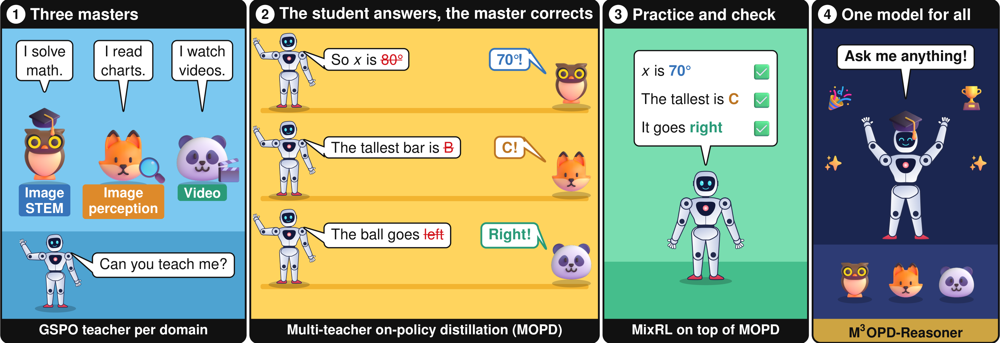
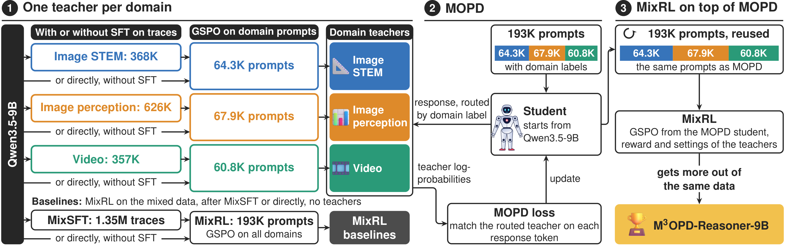

<div align="center">

# M³OPD-Reasoner

### An Open Recipe for Post-Training Multimodal Reasoning with Multi-Teacher On-Policy Distillation

**Nguyen Quang Trung**<sup>1</sup> · **Hoang Phan**<sup>2</sup> · **Shuo Sun**<sup>1</sup> · **Longyin Zhang**<sup>1</sup> · **AiTi Aw**<sup>1</sup>

<sup>1</sup>A\*STAR · <sup>2</sup>VinUniversity

[](https://ngquangtrung57.github.io/m3opd-reasoner-page/)
[](https://arxiv.org/abs/2611.23034)
[](https://www.alphaxiv.org/abs/2611.23034)
[](https://huggingface.co/collections/ngqtrung/m3opd-reasoner-6aed5164d151b6643a1b3b2d)
[](https://huggingface.co/datasets/ngqtrung/M3OPD-SFT-1.35M)
[](https://huggingface.co/datasets/ngqtrung/M3OPD-RL-193K)



</div>

## Overview

M³OPD-Reasoner is a fully open recipe for post-training a vision-language model on three reasoning domains:
**image STEM**, **image perception** and **video**. Starting from Qwen3.5-9B, it has three stages:

1. **GSPO teachers.** One teacher per domain, trained with GSPO directly from Qwen3.5-9B on the RL prompts of that domain.
2. **MOPD.** One student samples on the union of the prompts, and the teacher of each prompt's domain scores every
   response token (top-32 reverse KL). The student closely matches each teacher on its own domain.
3. **MixRL on top of MOPD.** GSPO on the same prompts, from the MOPD student. The same data still improve the student,
   with no collapse, and give the main model, **M3OPD-Reasoner-9B**.

MOPD and MixRL complement each other: MOPD merges the domain teachers into a stronger starting point for RL than the
base model, and MixRL still improves this student on the same data. We release the data, this training code and the
checkpoints of every stage, including the compared SFT warm-up recipe and the mixed-training baselines.

<p align="center"></p>

## Results

Mean avg@8 accuracy (%) over the benchmarks of each domain, after decontamination of the training data against
all 21 benchmarks. Bold marks the best single model in each column; the teachers row combines three models. The
per-benchmark results and the comparison with other reasoning VLMs are on the
[project page](https://ngquangtrung57.github.io/m3opd-reasoner-page/) and in the [paper](https://arxiv.org/abs/2611.23034).

| Model | Image STEM (8) | Image perception (8) | Video (5) | Overall (21) |
|---|:-:|:-:|:-:|:-:|
| Qwen3.5-9B | 70.0 | 78.9 | 53.4 | 69.4 |
| MixSFT + MixRL (baseline) | 73.8 | 80.4 | 62.1 | 73.5 |
| MixRL from Qwen3.5-9B (baseline) | 74.9 | 80.8 | 63.4 | 74.4 |
| Domain teachers (each on its own domain) | 76.7 | 81.2 | 63.4 | 75.2 |
| MOPD student | 76.6 | 81.4 | 63.2 | 75.2 |
| **M3OPD-Reasoner-9B** (MOPD + MixRL) | **77.1** | **81.9** | **64.1** | **75.9** |

## Released data and models

All items are in the [M3OPD-Reasoner collection](https://huggingface.co/collections/ngqtrung/m3opd-reasoner-6aed5164d151b6643a1b3b2d).

| Item | Hugging Face |
|---|---|
| SFT traces (1.35M samples) | [M3OPD-SFT-1.35M](https://huggingface.co/datasets/ngqtrung/M3OPD-SFT-1.35M) |
| RL prompts (193K) | [M3OPD-RL-193K](https://huggingface.co/datasets/ngqtrung/M3OPD-RL-193K) |
| **Main model** (MOPD + MixRL) | [M3OPD-Reasoner-9B](https://huggingface.co/ngqtrung/M3OPD-Reasoner-9B) |
| MOPD student | [M3OPD-MOPD-9B](https://huggingface.co/ngqtrung/M3OPD-MOPD-9B) |
| Domain teachers (GSPO from Qwen3.5-9B) | [M3OPD-Teacher-ImageSTEM-9B](https://huggingface.co/ngqtrung/M3OPD-Teacher-ImageSTEM-9B), [M3OPD-Teacher-ImagePerception-9B](https://huggingface.co/ngqtrung/M3OPD-Teacher-ImagePerception-9B), [M3OPD-Teacher-Video-9B](https://huggingface.co/ngqtrung/M3OPD-Teacher-Video-9B) |
| SFT warm-up recipe: SFT warm-ups | [M3OPD-Warmup-SFT-ImageSTEM-9B](https://huggingface.co/ngqtrung/M3OPD-Warmup-SFT-ImageSTEM-9B), [M3OPD-Warmup-SFT-ImagePerception-9B](https://huggingface.co/ngqtrung/M3OPD-Warmup-SFT-ImagePerception-9B), [M3OPD-Warmup-SFT-Video-9B](https://huggingface.co/ngqtrung/M3OPD-Warmup-SFT-Video-9B) |
| SFT warm-up recipe: teachers | [M3OPD-Warmup-Teacher-ImageSTEM-9B](https://huggingface.co/ngqtrung/M3OPD-Warmup-Teacher-ImageSTEM-9B), [M3OPD-Warmup-Teacher-ImagePerception-9B](https://huggingface.co/ngqtrung/M3OPD-Warmup-Teacher-ImagePerception-9B), [M3OPD-Warmup-Teacher-Video-9B](https://huggingface.co/ngqtrung/M3OPD-Warmup-Teacher-Video-9B) |
| SFT warm-up recipe: MOPD student and MixRL on top | [M3OPD-Warmup-MOPD-9B](https://huggingface.co/ngqtrung/M3OPD-Warmup-MOPD-9B), [M3OPD-Warmup-MixRL-9B](https://huggingface.co/ngqtrung/M3OPD-Warmup-MixRL-9B) |
| Baselines: MixSFT, MixRL from MixSFT, MixRL from Qwen3.5-9B | [M3OPD-MixSFT-9B](https://huggingface.co/ngqtrung/M3OPD-MixSFT-9B), [M3OPD-MixRL-Baseline-9B](https://huggingface.co/ngqtrung/M3OPD-MixRL-Baseline-9B), [M3OPD-MixRL-From-Base-9B](https://huggingface.co/ngqtrung/M3OPD-MixRL-From-Base-9B) |

## Quick start

Every model has the architecture, tokenizer, processor and chat template of
[Qwen3.5-9B](https://huggingface.co/Qwen/Qwen3.5-9B), so it runs wherever Qwen3.5-9B runs (Transformers, vLLM, SGLang). We train and
evaluate with the native chat template, thinking enabled, no system prompt, and one answer-format line after the
question, for example `Put your final answer within \boxed{}.`

```bash
vllm serve ngqtrung/M3OPD-Reasoner-9B --max-model-len 40960
```

## Repository layout

```
configs/sft/           lmms-engine configs of the 4 SFT runs (3 warm-ups and MixSFT; the main recipe has no SFT run)
configs/rl/            verl overrides of the 12 RL runs: the 5 of the main recipe, the 5 `warmup_*` runs and the two MixRL
                       baselines (gspo_common.sh is shared by the 10 GSPO runs)
configs/chat_template.jinja   chat template of Qwen3.5-9B (used for RL rollouts)
m3opd/reward/          rule-based reward (verl custom_reward_function)
m3opd/data/prepare.py  Hugging Face datasets -> training files
m3opd/ckpt.py          finishes a merged checkpoint (vision key names, generation config, processor files)
patches/               our changes to verl and lmms-engine
scripts/               setup, train and merge scripts
```

## Setup

```bash
pip install -r requirements.txt            # Python 3.12, CUDA 12.8; see the file for the exact versions
bash scripts/setup_third_party.sh          # verl v0.9.1 and lmms-engine at pinned commits + patches/
pip install -e third_party/verl && pip install -e third_party/lmms-engine
export BASE_MODEL=/path/to/Qwen3.5-9B DATA_DIR=/path/to/data CKPT_DIR=/path/to/checkpoints
```

## Data

Download both datasets with their media zip shards:

```bash
hf download ngqtrung/M3OPD-SFT-1.35M --repo-type dataset --local-dir data_hf/sft
hf download ngqtrung/M3OPD-RL-193K --repo-type dataset --local-dir data_hf/rl
```

Then:

```bash
python -m m3opd.data.prepare --sft-dir <M3OPD-SFT-1.35M dir> --rl-dir <M3OPD-RL-193K dir> --out $DATA_DIR
```

This writes the SFT shards (`$DATA_DIR/sft/<domain>/`, and `$DATA_DIR/sft/mix/` for MixSFT) and one RL parquet per
domain (`$DATA_DIR/rl/<domain>/data.parquet`). The main recipe reads only the RL files; the SFT shards serve the
compared runs.

## Training

All nodes have 8 H100 80GB GPUs, and every config runs on 4 nodes: SFT on 4 nodes, GSPO on 2 trainer + 2 rollout
nodes, and MOPD on 2 trainer + 1 rollout + 1 teacher node. SFT runs `bash scripts/train_sft.sh <config>` on every node (set `NNODES`, `NODE_RANK`,
`MASTER_ADDR`). For RL, start Ray on the nodes of the run (`bash scripts/ray_start.sh <run> head` on node 0,
`bash scripts/ray_start.sh <run> <node 0 address>` on the others), then run `bash scripts/train_rl.sh <run>` on node 0. After each run, merge a checkpoint to `$CKPT_DIR/<run>/hf` with `bash scripts/merge_rl.sh <run> <step>` (SFT: `bash scripts/merge_sft.sh <config name> <step>`); the next stage reads it.

**Main recipe** (no SFT; every stage starts from Qwen3.5-9B or from the stage before):

| Stage | Train | Nodes |
|---|---|---|
| GSPO teacher, image STEM | `train_rl.sh teacher_image_stem` | 4 (2 trainer + 2 rollout) |
| GSPO teacher, image perception | `train_rl.sh teacher_image_perception` | 4 (2 trainer + 2 rollout) |
| GSPO teacher, video | `train_rl.sh teacher_video` | 4 (2 trainer + 2 rollout) |
| MOPD | `train_rl.sh mopd` | 4 (2 trainer + 1 rollout + 1 teacher) |
| **MixRL on top of MOPD** (M3OPD-Reasoner-9B) | `train_rl.sh mixrl_on_mopd` | 4 (2 trainer + 2 rollout) |

**Compared runs.** The SFT warm-up line has the same stages, with teachers that start from an SFT warm-up (the
`warmup_*` stages read the merged checkpoints of the SFT runs and of each other). The baselines train one model on
the mixed data.

| Stage | Train | Nodes |
|---|---|---|
| SFT warm-up, image STEM | `train_sft.sh configs/sft/sft_image_stem.yaml` | 4 |
| SFT warm-up, image perception | `train_sft.sh configs/sft/sft_image_perception.yaml` | 4 |
| SFT warm-up, video | `train_sft.sh configs/sft/sft_video.yaml` | 4 |
| Warm-up GSPO teacher, image STEM | `train_rl.sh warmup_teacher_image_stem` | 4 (2 trainer + 2 rollout) |
| Warm-up GSPO teacher, image perception | `train_rl.sh warmup_teacher_image_perception` | 4 (2 trainer + 2 rollout) |
| Warm-up GSPO teacher, video | `train_rl.sh warmup_teacher_video` | 4 (2 trainer + 2 rollout) |
| Warm-up MOPD | `train_rl.sh warmup_mopd` | 4 (2 trainer + 1 rollout + 1 teacher) |
| Warm-up MixRL on top of MOPD | `train_rl.sh warmup_mixrl_on_mopd` | 4 (2 trainer + 2 rollout) |
| Baseline: MixRL from Qwen3.5-9B | `train_rl.sh mixrl_from_base` | 4 (2 trainer + 2 rollout) |
| Baseline: MixSFT | `train_sft.sh configs/sft/mixsft.yaml` | 4 |
| Baseline: MixRL from MixSFT | `train_rl.sh mixrl_baseline` | 4 (2 trainer + 2 rollout) |

Scripts are in `scripts/`. Each config file states its start model and layout. The RL runs keep every checkpoint
(`trainer.max_actor_ckpt_to_keep=null`) and have no online validation; logs go to the console and Weights & Biases.

## Citation

```bibtex
@article{m3opdreasoner2026,
  title   = {M$^3$OPD-Reasoner: An Open Recipe for Post-Training Multimodal Reasoning
             with Multi-Teacher On-Policy Distillation},
  author  = {Nguyen Quang Trung and Hoang Phan and Shuo Sun and Longyin Zhang and AiTi Aw},
  journal = {arXiv preprint arXiv:2611.23034},
  year    = {2026}
}
```

## Acknowledgments

The training builds on [verl](https://github.com/volcengine/verl) (RL and MOPD) and
[lmms-engine](https://github.com/EvolvingLMMs-Lab/lmms-engine) (SFT), and starts from
[Qwen3.5-9B](https://huggingface.co/Qwen/Qwen3.5-9B).

## License

The code is released under Apache-2.0, see `LICENSE`. The models keep the Apache-2.0 license of Qwen3.5-9B.
